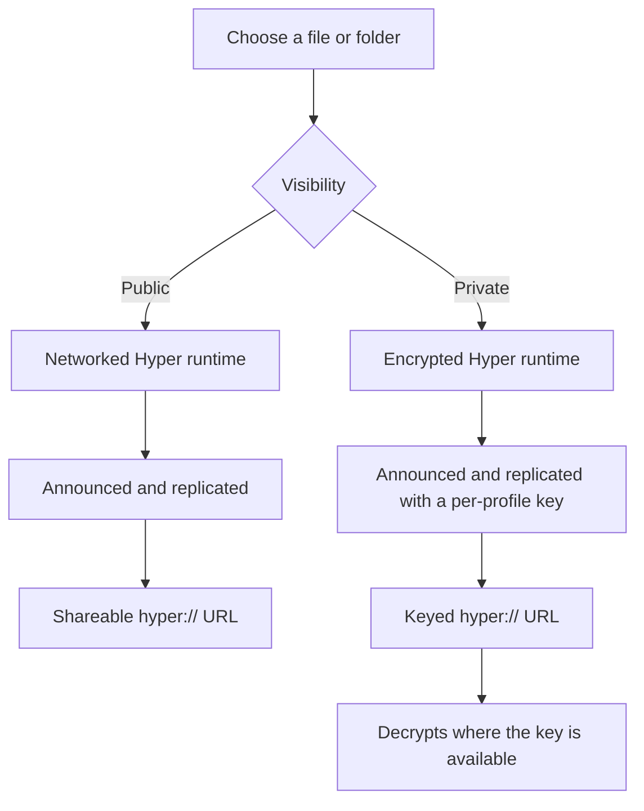
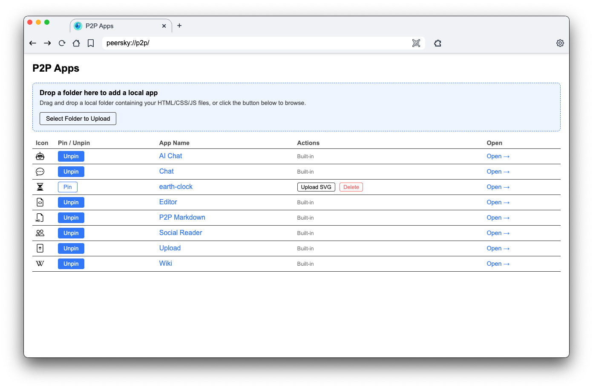

# P2P Apps

Peersky includes a section of static apps served from the `peersky://p2p/` namespace. These apps are fully local or served via distributed protocols like IPFS, Hypercore, etc. This allows building collaborative and offline-capable tools that do not rely on centralized servers.

## 🛠️ Building P2P static apps


Static apps work especially well with P2P protocols: they can be **served locally**, cached by peers, and stay available even when your origin server is offline. Publishing a bundle of HTML/CSS/JS to Hyper or IPFS gives you:

- **Offline / flaky-network resilience** – once content is seeded, peers can load it without a central server.
- **Versioned, content-addressed builds** – immutable URLs for each deploy, easy rollbacks and integrity checks.
- **Low/zero infra** – no origin to maintain; distribution happens over the P2P network.

### Publish to Hyper

```js
async function publishToHyper(file) {
  // Create (or reuse) a Hyperdrive keyed by "myapp"
  const params = new URLSearchParams({ key: 'myapp', visibility: 'public' });
  const response = await fetch(`hyper://localhost/?${params}`, {
    method: 'POST'
  });
  const hyperdriveUrl = await response.text(); // e.g. "hyper://abcdef.../"

  // Upload the static file into that drive
  const uploadUrl = `${hyperdriveUrl}${encodeURIComponent(file.name)}`;
  const uploadResponse = await fetch(uploadUrl, {
    method: 'PUT',
    body: file,
    headers: { 'Content-Type': file.type || 'text/html' }
  });

  if (uploadResponse.ok) {
    console.log('Published to:', uploadUrl);
    return uploadUrl;
  }
}
```

### Public and private Hyperdrive uploads

The Hyperdrive app asks for a visibility before creating an upload:

- **Public** uploads use PeerSky's normal networked Hyper runtime. Their discovery keys are announced, their contents can replicate to peers, and their `hyper://` URLs can be shared.
- **Private** uploads use a separate runtime over the same Hyper network, with block-level encryption applied from a per-profile 32-byte `encryptionKey`. They are announced and replicated (`autoJoin: true`, `doReplicate: true`) exactly like public drives, so their contents move between your devices. `hyper://` URLs are keyed and decrypt correctly only where that key is available — in the profile that created them and on devices that have adopted the key via an identity transfer. Setting `PEERSKY_PRIVATE_DEVICE_ONLY=1` restores the old device-only behavior (isolated runtime, no discovery or replication).

Each upload name selects its own Hyperdrive, so sharing one public upload does not expose unrelated uploads. Private upload metadata is kept in a separate local registry and is never added to the shared Hyper cache.

#### Private keys and names on this computer

The private drive key (`private-drive-key.json`), the names of private drives (`privateHyperdrives.json`) and the names and sizes of the files in your other devices' private drives (`device-sync.json`) are locked with the system's safe storage: the Keychain on macOS, DPAPI on Windows, the keyring on Linux, through Electron's `safeStorage` (`src/backup/sealed-file.js`). A copy of those files taken off the disk shows nothing, and nobody is asked for a password: only PeerSky, run by the same user on the same computer, opens them. Files from an earlier version are locked at the first start after the update, and one a restore puts back is locked the first time it is read. A locked key file that cannot be opened stops private drives rather than making a new key, which would lose every private drive. A backup or an identity transfer carries the key and the list of private drives unlocked inside its own encryption, since the computer or phone it goes to has a safe storage of its own and locks them with it at its next start. Safe storage only works on the main thread, so a passphrase backup, which is made in a worker, is handed them opened (`openSealedBackupFiles` in `src/backup/backup-core.js`), and a locked file that cannot be opened stops the backup instead of going in useless. On Linux, Electron picks the keyring from the desktop's name, and on one it does not know, such as Raspberry Pi OS, i3 or Sway, it falls back to a password built into every copy of Chromium, which locks nothing, so these files stay plain there. Many of those systems still run GNOME Keyring: when Electron fell back and the keyring is already unlocked, PeerSky uses it from the next start on and keeps it (`src/linux-keyring.js`, remembered in `password-store.json`). A locked or missing keyring is left alone, so a Raspberry Pi that logs in by itself is never asked for a password at boot. Secrets locked before with the built-in password still open after the switch. To lock them on such a computer, unlock GNOME Keyring at login, or start PeerSky with `--password-store=gnome-libsecret`, which PeerSky never overrides; full-disk encryption covers the rest of the disk.

Private drives made before private uploads were encrypted (registry entries with no `encrypted`) sat on the disk as plain blocks, though they never went on a network. At the private store's start each is copied once into a new encrypted drive, the list points at the new one, and the old drive's blocks are cleared, leaving only hashes (`encryptLegacyPrivateDrives` in `src/protocols/private-hyperdrive.js`). The new drive has a new address. Stopping part way loses nothing: the copy is made again from the old drive, or put on the list if the old drive was already cleared.

#### Private files from your other devices

A profile's private uploads also show up on the person's other devices, and theirs here, with no link to send. The devices that hold this profile's private drive key, which Link Device carries to the phone, meet on the private store's swarm under a topic made from that key, prove on each connection that they hold it, and only then say whether they are a phone or a desktop and which private drives they write (`src/protocols/device-sync*.js`, the same protocol as PeerSky Mobile's `backend/hyper/device-sync*.mjs`, with a shared test vector).

A phone's drive is added to the private drives as `Private files from your phone`, read-only, the way Link Device adds it, and every file in it is copied here as it arrives, so it opens with the phone asleep. The copying waits while the phone says it is on a cellular connection. The Hyperdrive app lists the files under **From your devices** (`device-sync-list`, answered for `peersky://p2p/hyperdrive/` alone). A new private drive made here is announced to the devices online at once. The private store now starts with Hyper when the profile has a private key, so a phone is met without anything private being opened first. The phone's docs, `docs/hyper.md`, have the frames, the limits and what happens at the edges.

#### Your own private uploads

The Hyperdrive app lists this desktop's own private uploads under **Your private uploads**, newest first and at most 100, so they are still there after a restart, the way the phone keeps its own under Recent (`private-files-list`, answered for `peersky://p2p/hyperdrive/` alone). Each private upload goes in a drive named after it, which the registry keeps (`privateHyperdrives.json`), and the list is read from the top of each drive this desktop made (`src/protocols/own-private-files.js`), as the phone lists them under From your devices. Notes P2PMD publishes in private are in its `p2pmd` drive, so they are listed too. Drives from other devices, and ones a restore brought here, are left out. A shared folder's link opens in the Files, Photos or Videos view, as any folder does (below).

Only PeerSky's own pages, the drive's own pages and a tab you open it in can make, read or write a private drive (`mayUsePrivateDrive` in `src/protocols/request-gate.js`). Electron applies no CORS to `hyper://`, so without this any site that learned a private drive's address could read it with this desktop's key. An app added under `peersky://myapps/` is not one of PeerSky's own pages: a private drive is opened by its name, so such an app could otherwise open the drive P2PMD keeps private notes in by asking for it by name. The phone has the same rule.

The private store sends a file the way public files are sent (`src/protocols/private-hyperdrive.js`). It answers a `Range` request (`bytes=start-end`, `bytes=start-` or `bytes=-length`) with `206` and just those bytes, read from the drive as they go out, so a private video seeks and a page reading the start of a photo gets only that. A range past the end gets `416`, and a `HEAD` gets the length and `Accept-Ranges: bytes` without the bytes. A file written there keeps when it was written, as hypercore-fetch keeps it for public drives: the `Last-Modified` the page sent, or the time of the write. Reads send it back as `Last-Modified`. Files written before this have no time.



Private uploads are excluded from normal backups by default. Identity transfers include them by default because they move data to another user-owned device. Both controls are explicit: if private uploads are excluded, Link Device shows how many will be left behind. The same page lists the private uploads currently stored on the device. The transfer ships the drive's encryption key file (`private-drive-key.json`) beside the synced store; on arrival the receiving device adopts the drive into that keyed, synced corestore, so the same encrypted drive can be opened and written on both sides. The key file is what binds a received drive to a device — without it the drive's blocks remain encrypted no matter how far they replicate.

#### Folders open in Files, Photos or Videos

A tab that opens a `hyper://` folder that is no website gets the Hyperdrive app's views instead of the plain list of its files. That is a folder hypercore-fetch answers with its list, or with a readme it serves in place of the list: `README.md`, `README.org`, `index.md`, `index.gmi`, `index.gemini` or `index.org`, in any case, which the views show under the list. `src/protocols/hyper-handler.js` answers the tab with a redirect to `peersky://p2p/hyperdrive/files/<host><folder>?auto`: `<host>` is the address's host in lower case, and each name in `<folder>` is encoded on its own with `encodeURIComponent`. With `?auto`, the views pick Files, Photos or Videos from what the folder holds. `peersky://p2p/hyperdrive/files/`, `photos/` and `videos/`, alone or with a drive and folder after them, all serve one page, `viewer/index.html` in the Hyperdrive app (`src/pages/p2p/hyperdrive`), whose files are under `peersky://p2p/hyperdrive/viewer/`.

What stays as it was:

- A page's own `fetch()` of a folder, a `HEAD`, a frame and a service worker get the list. Only a tab loading the folder is sent to the views (the request gate's navigation stamp).
- A public folder with an `index.html` is a website and shows it. hypercore-fetch never serves `index.htm` for a folder, so a folder with only that lists, and opens in the views like any other. The private store serves no index files, so a private folder always opens in the views.
- A readme's own address, such as `hyper://<host>/notes/README.md`, opens the file.
- `?raw`, and hypercore-fetch's own `?noResolve`, never go to the views: `?raw` gets what hypercore-fetch serves, a readme included, and `?noResolve` the plain list. The views link to it as Raw listing.
- A private drive keeps its rules on who may read it. A tab may, so a private folder opens in the views too, and a site that knows the address still gets a 403. The private store names a folder it lists in a `Link` header, as hypercore-fetch does, which is how a list is told from a page.
- A Hyperdrive app without the views, an older submodule, leaves every folder as the plain list.

The views ask the main process through `window.electronAPI.hyperdrive`. The preload hands it to the P2P app pages, and the main process answers pages under `peersky://p2p/hyperdrive/` alone (`src/protocols/hyperdrive-views-ipc.js`):

- `list(url, { recursive })` (`hyperdrive-list`) gives every file under the folder as `{ entries: [{ path, size, mtime }], truncated, private, writable }`. `path` is the file's path in the drive, not encoded. `size` is in bytes, and `mtime` in milliseconds or `null` when the drive has none. Files only, at most 50,000, and `truncated` says there were more. At the top of a drive this computer made, the answer also has `name`, the name it was made under: an upload's or a backup's in the Hyper cache, or a private drive's in its registry. There is no `name` for any other drive, or for a public upload given no name of its own, and none is ever made up from the address. The views show it in place of the shortened key. The drive opens as a tab's read of it does: a public one after up to 30 seconds of looking for peers, a private one from the private store, a linked device's with the profile key. When it cannot list, it answers `{ code, message }`, with `code` one of `not-found`, `no-peers`, `private`, `timeout` and `unknown`.
- `cacheEpoch()` (`hyperdrive-cache-epoch`) gives a number kept in `hyperdrive-views.json` in the profile. Reset P2P Data raises it, and the views drop the pictures and details they keep when it changes.
- `download(url)` (`hyperdrive-download`) saves a drive's file like any other download. An `<a download>` link on a `peersky://` page to a `hyper://` file would open the file in the tab instead, since Chromium ignores `download` for another origin's file.

### Publish to IPFS

```js
async function publishToIPFS(files) {
  const formData = new FormData();
  for (const file of files) {
    formData.append('file', file, file.name);
  }

  // Example writable IPFS root; in practice you will use
  // a CID or path that your node exposes for writes.
  const response = await fetch('ipfs://bafyaabakaieac/', {
    method: 'PUT',
    body: formData
  });

  if (response.ok) {
    const ipfsUrl = response.headers.get('Location'); // e.g. "ipfs://bafy.../index.html"
    console.log('Published to:', ipfsUrl);
    return ipfsUrl;
  }
}
```

> [!NOTE]
> Writes from a website, a Hyper or IPFS site, or a local file need the user's consent. The first `PUT`, `POST` or `DELETE` to `hyper://`, `ipfs://` or `ipns://` from a site shows a **P2P publishing** prompt, and the answer is remembered for that site in site settings. Built-in `peersky://` apps write without a prompt. An app added under `peersky://myapps/` asks like any site. Writes from service workers are refused, since they cannot show one.

Check our p2p apps in `/pages/p2p/`: https://github.com/p2plabsxyz/peersky-browser/tree/main/src/pages/p2p

## 🤖 LLM-powered P2P apps

To build P2P apps that call a local or cloud LLM from the browser, see [`docs/LLM.md`](./LLM.md) for the `window.llm` API, configuration, and examples.

## ⚡ Real-time P2P apps

Build collaborative real-time apps using [Holesail](https://holesail.io/) for direct peer-to-peer connections with live synchronization.

### 1) Start a Holesail server

```js
import Holesail from "holesail";

const server = new Holesail({
  server: true,
  secure: true,
  port: 8989
});

await server.ready();
console.log("Share this key:", server.info.url);
```

To host the same note again later, pass its key. A private key (`hs://s000…`) is the secret the server's keys are hashed from, so the key alone brings the same note back:

```js
const again = new Holesail({ server: true, key: "hs://s000yourkeyhere", port: 8989 });
```

A public key (`hs://0000…`) is the server's public key and gives no seed, so keep `server.dht.seed` from the first run and set it on a server made without a key, before `ready()`. Never do that for a private key: Holesail then makes up a key of its own, and `info.url` names an address nobody can reach while the note is still served at its real one.

### 2) Connect a client

```js
import Holesail from "holesail";

const client = new Holesail({
  client: true,
  key: "hs://s000yourkeyhere"
});

await client.ready();
console.log("Connected:", client.info);
```

More: https://docs.holesail.io/

### 3) Sync realtime state

Use HTTP endpoints (GET/POST) plus SSE/WebSocket for live updates. In PeerSky, a custom [hs-handler](https://github.com/p2plabsxyz/peersky-browser/blob/main/src/protocols/hs-handler.js) can expose these endpoints while keeping the transport peer-to-peer. Incremental Yjs CRDT updates are exchanged over HTTP/SSE, while peer presence metadata is sent through presence endpoints.

With more than a few people, keep what goes out small. Send each change, not the whole state. Send presence, such as who is here and where their cursor is, on a timer a few times a second rather than on every keystroke. Send per-person data that rarely changes, such as who wrote which line, only when it changes, and in full to whoever joins. P2PMD does all three, so a note holds about 100 people: at 100 people with 10 typing, each device receives about 33 KB a second and the host sends about 3.4 MB a second, headers and replies included, and every copy ends the same (`npm run test:load:p2pmd`, run on 2026-10-12; see `test/load/p2pmd/README.md`).

**Example:** See [p2pmd](https://github.com/p2plabsxyz/peersky-browser/tree/main/src/pages/p2p/p2pmd) for a complete real-time collaborative markdown editor implementation.

### With no internet

Holesail finds a host on the public HyperDHT, which is on the internet, so with the router's cable out a note did not open even with both devices on the same Wi-Fi, and a note could not even be hosted. PeerSky now also hosts every `hs://` note on the local network DHT that Hyperdrive and PeerChat already use over Wi-Fi (`src/protocols/p2pmd-lan.js`):

- The host listens there under the note's own key pair and says over mDNS that it has a topic made from the note's key. Only someone who has the link can work out the topic, and a private note still lets in only the key its link carries.
- A device joining looks on the local network first (2.5 seconds, under a second when no other PeerSky is around) and uses it if the host answers there within 3 seconds. Otherwise it goes to the internet as before, as on a Wi-Fi that keeps devices apart.
- With no internet, hosting goes on after 3 seconds with the note on the local network alone, and keeps trying the internet every minute.
- With no local network either, as with Wi-Fi off or the local port taken by another app, the note is still made on this computer, the same as any document. The local network is tried every 10 seconds and the internet every minute, and the note goes up on each as it answers.

The tunnel is the same Noise-encrypted one Holesail opens, so nothing in between can read the note. Notes hosted over UDP stay internet-only. Tests: `test/p2p/p2pmd-lan.test.js`.

## Web3 protocol

For `web3://` examples (contract reads, HTML resources, and `fetch` usage), see [`docs/web3.md`](./web3.md).

## 📄 p2p-list.js

The file [`p2p-list.js`](../src/pages/p2p/p2p-list.js) manages both built-in static apps and user-imported P2P applications.
It exports the hardcoded `p2pApps` array for built-in apps, and dynamic helper functions to resolve and retrieve apps:

- `getAllApps()`: Returns a combined array of all built-in apps and dynamically uploaded user apps (via IPC).
- `getPinnedApps()`: Returns an array of pinned app IDs (async, reads from the main-process settings via IPC).
- `setPinnedState(id, pinned)`: Updates the `pinnedP2PApps` setting. Saving this setting triggers the main process to broadcast a `pinned-apps-changed` event to natively sync the home screen P2P bar dynamically across all windows.
- `isPinned(id)`: Checks if a specific app is pinned (async).

### Managing apps at peersky://p2p/



The page at `peersky://p2p/` (`pages/p2p/index.html`) serves as the core P2P app management registry. It uses a `<p2p-app-manager>` web component with full drag-and-drop support, displaying a table with columns:

| Icon | Pin / Unpin | App Name | Actions (SVG icon upload, Delete) | Open |
|---|---|---|---|---|

Pin/unpin changes are persisted via the main-process settings system (`pinnedP2PApps` key), updating the home screen P2P bar dynamically.

**To register a new P2P app:**
1. **(Users)** Easily drag-and-drop any standard HTML/CSS/JS web folder directly onto the dropzone via the UI. The application gets locally wrapped and assigned a `peersky://myapps/...` protocol URL. It came from somewhere else, so it is treated like a website: it asks before it publishes or uses AI, and it cannot use private drives or read the AI memory.
2. **(Core Developers)** Add the folder for native components in `./src/pages/p2p/`, and explicitly register it into the `p2pApps` list located in `p2p-list.js`.

## Git Submodules for Built-in P2P Apps

Built-in P2P apps (peerchat, peerpad, upload, p2pmd, ai-chat, wiki, peertunes) are maintained as independent Git repositories and included as submodules. This allows each app to be developed and versioned separately.

**Automatic initialization:**
```bash
npm install  # Automatically runs: git submodule update --init --recursive
```

**Updating apps to latest versions:**
- **Via UI**: Navigate to `peersky://p2p/` and click the "Update All" button at the bottom. In a development checkout this runs the command below. An installed PeerSky never rewrites its own P2P apps: the button checks for a PeerSky update instead, and new app versions arrive with it, pinned and signed. It used to unpack each app's latest GitHub zip into `app.asar.unpacked`, but an installed app cannot see files added after it was built, and PeerSky stopped starting when an update added one.
- **Via CLI**: `git submodule update --remote --merge`

The update pulls the latest commit from each submodule's default branch. After updating, commit the new submodule pointers:
```bash
git add src/pages/p2p/
git commit -m "Update P2P apps to latest versions"
```

**Submodule configuration:**
Submodules are defined in `.gitmodules` (auto-managed by Git) and point to repositories under [github.com/p2plabsxyz](https://github.com/p2plabsxyz).
